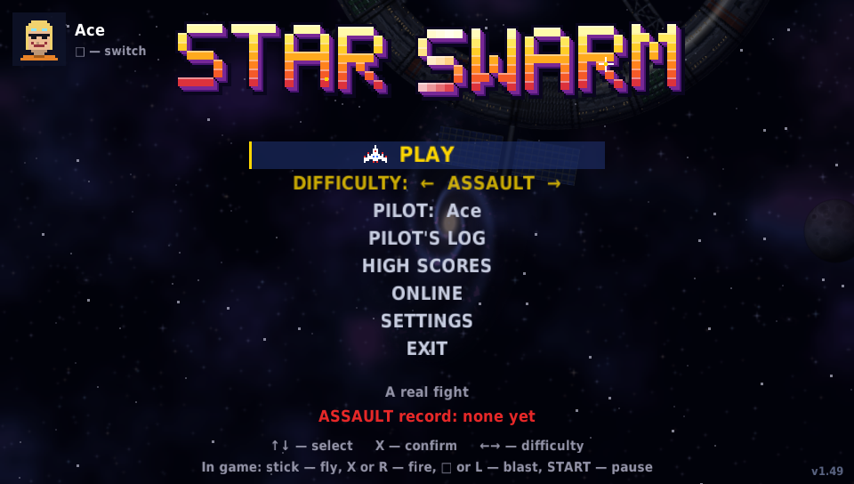
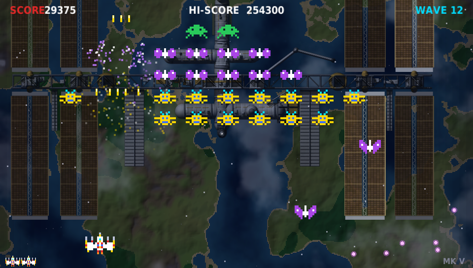
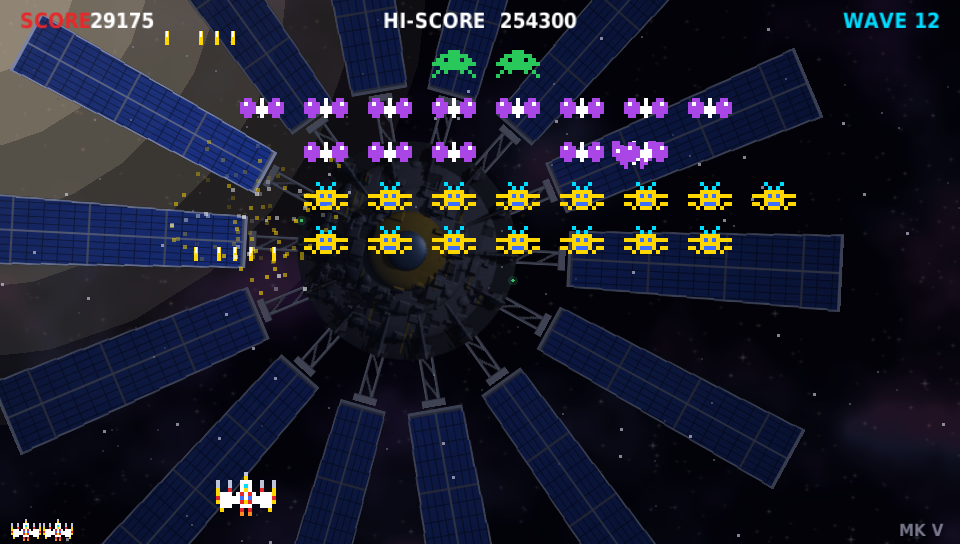
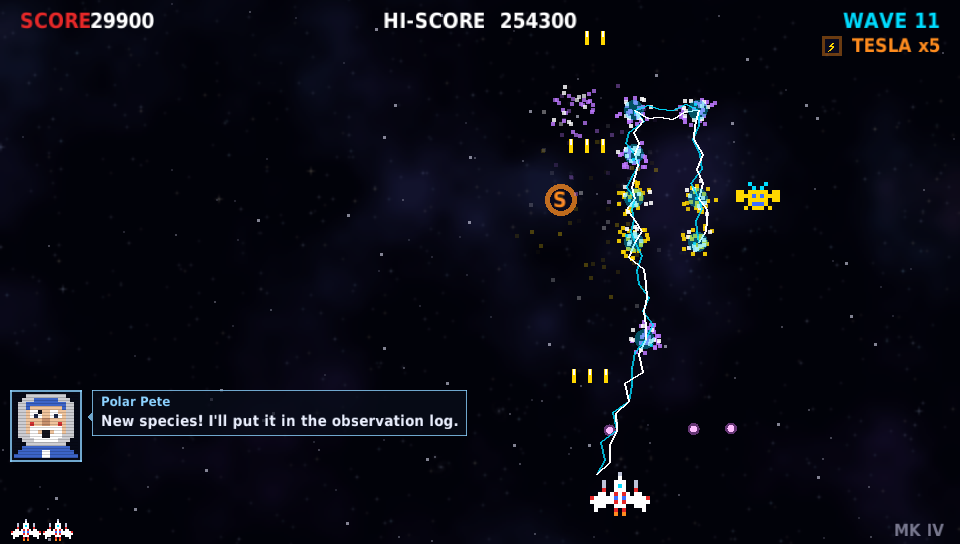
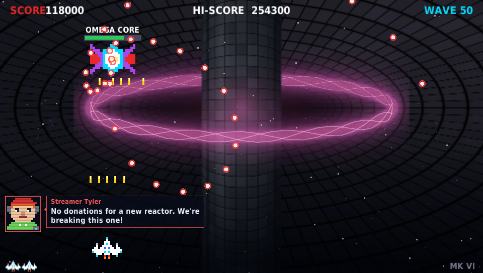
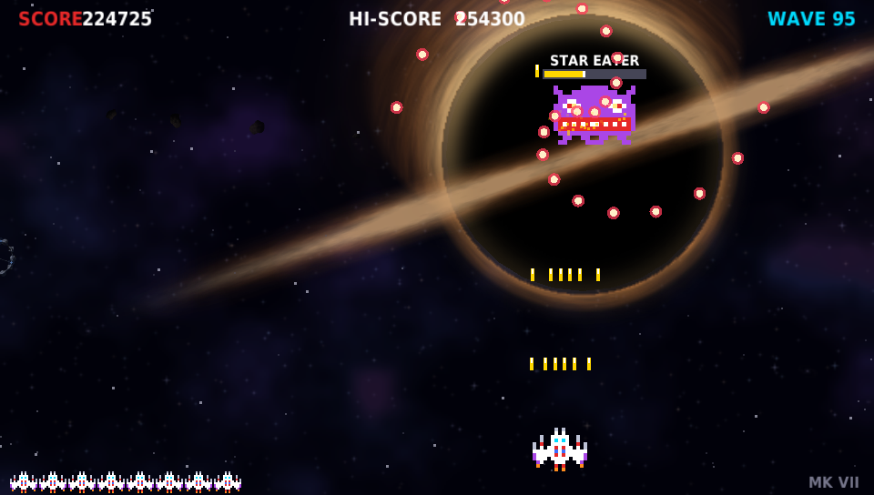
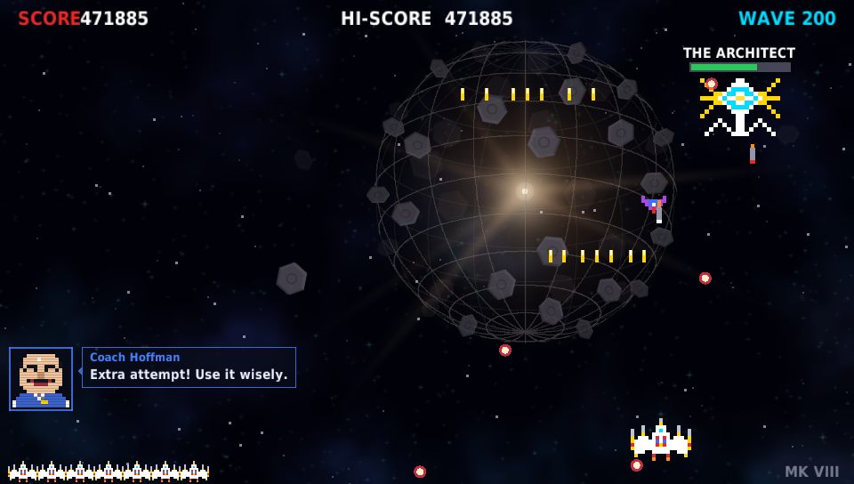
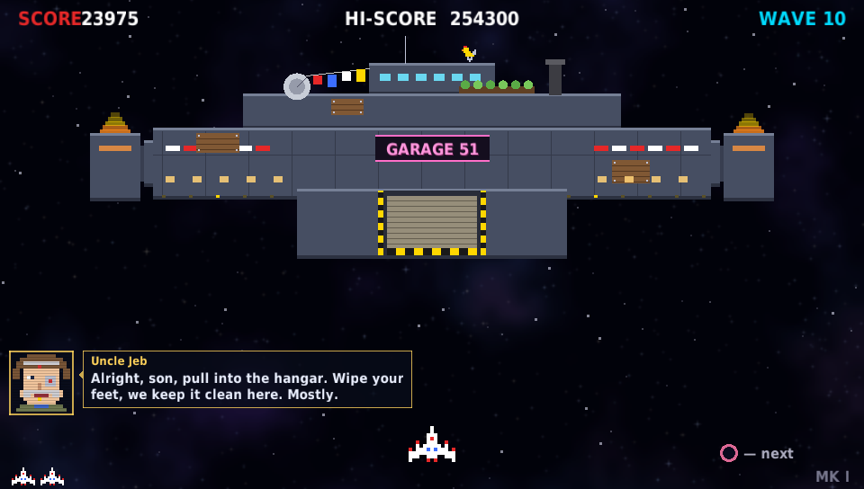
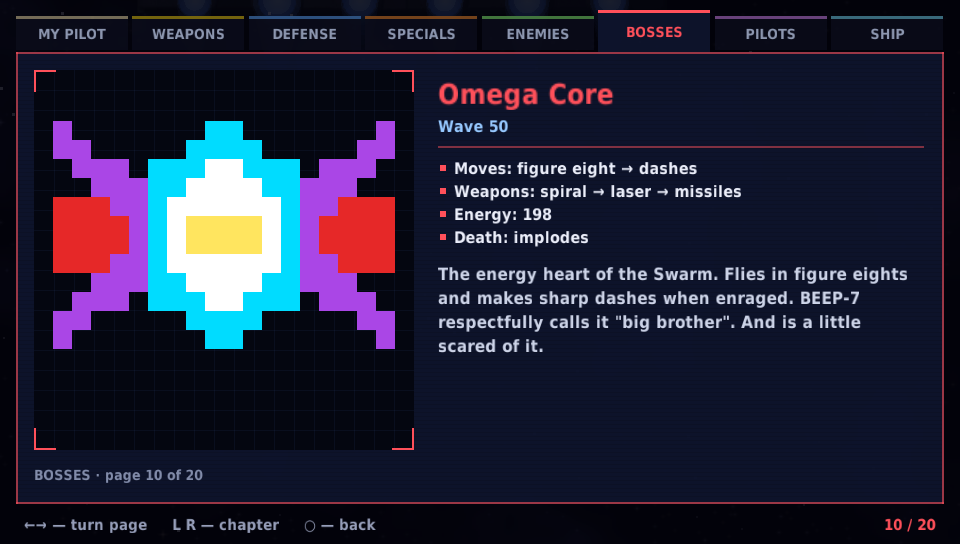
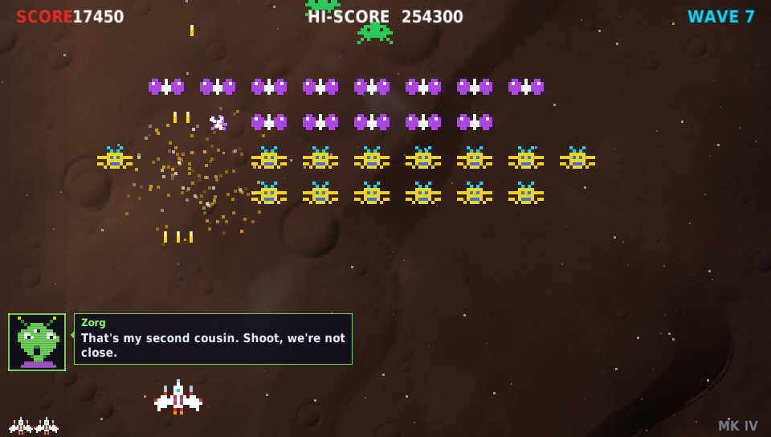

# Star Swarm

**A Galaga-style arcade shooter for PS Vita: 20 bosses, 25 locations, a pilot's log and online races.**

[**⬇ Download the latest StarSwarm.vpk**](https://github.com/AnTaiCa/starswarm-vita/releases/latest/download/StarSwarm.vpk) · [All releases](https://github.com/AnTaiCa/starswarm-vita/releases)

Star Swarm is an arcade shoot 'em up in the spirit of Galaga, made from scratch for PS Vita. The Swarm flies in from deep space in formations, dives at your ship and shoots back, and every fifth wave a boss arrives. How far can you get?

## Screenshots

| | |
|---|---|
|  |  |
| Above Earth, past the ISS | A solar power station |
|  |  |
| Tesla chain lightning | Omega Core in its reactor |
|  |  |
| Star Eater at the event horizon | The Architect's workshop |
|  |  |
| Garage 51 upgrades your ship | The Pilot's Log |
|  | |
| A flight over Mars | |

## Features

- **20 bosses**, each with its own flight path, weapons and death animation. At 40% energy they get angry and change tactics. Some fight in their own arenas: inside the Omega Core's reactor, in front of the Star Eater's black hole, in the Architect's workshop.
- **15 enemy types**: snipers, wasps, healers, splitters, guards with energy shields, ghosts and more, in 22 formations.
- **7 weapons, 5 defences** (shield, shadow twin, ball lightning, wingmen, reflector) and **6 special weapons**: nuke, grenades, drones, Tesla chain lightning, EMP and a black hole.
- **Ship upgrades at Garage 51**: a mothership with a cornfield, a cow and Uncle Jeb pulls your ship into the hangar and sends out a new model. MK I to MK VIII, and beyond.
- **25 locations**: flights over Mars, the Moon, Jupiter and an ice world, the ISS above Earth, a shipyard, a solar power station, a launch dock, an event horizon. Plus **17 deep-space scenes**: a pulsar, the Pillars of Creation, the Crab Nebula and others.
- **22 radio pilots** comment on the fight, with more than 1,000 lines and plenty of jokes.
- **Pilot's Log**: 86 illustrated pages about every weapon, enemy, boss and pilot. Enemies stay classified until you meet them.
- **Up to 5 player profiles** with pixel portraits, ranks from Cadet to Galactic Marshal, and a high score table for each of the 5 difficulty levels.
- **Online, optional**: a daily challenge with the same waves for everyone, world leaderboards with country flags, and races for up to 5 pilots (bots take the free seats). A recovery code moves your pilot to another console.
- **71 original music tracks.** Replace any of them with your own MP3 in `ux0:data/STSW00001/music/`.
- **English and Russian.** The language follows the console setting and can be changed in Settings.

## Controls

| Button | Action |
|---|---|
| Left stick / D-pad | Move |
| X or R | Fire (hold) |
| □ or L | Special weapon |
| START | Pause and settings |

## Install

1. Download `StarSwarm.vpk` from the [latest release](https://github.com/AnTaiCa/starswarm-vita/releases/latest).
2. Copy it to your Vita (HENkaku / h-encore / Enso) and install it with VitaShell.

No plugins or extra data files are needed. Online features need Wi-Fi.

Saves are in `ux0:data/STSW00001/`. Installing a new version over the old one keeps your pilots and records.

## Русский

Аркадный шутер в духе Galaga для PS Vita: 20 боссов, 25 локаций, журнал пилота, онлайн-рекорды и гонки. Игра на русском и английском, язык — как у консоли (меняется в настройках).

Установка: скачай `StarSwarm.vpk` из [последнего релиза](https://github.com/AnTaiCa/starswarm-vita/releases/latest), скопируй на Vita и установи в VitaShell. Новая версия ставится поверх старой, пилоты и рекорды сохраняются.

## About

Made by AnTaiCa, developed with the help of Claude (Anthropic's AI assistant). This repository holds the release builds only.
